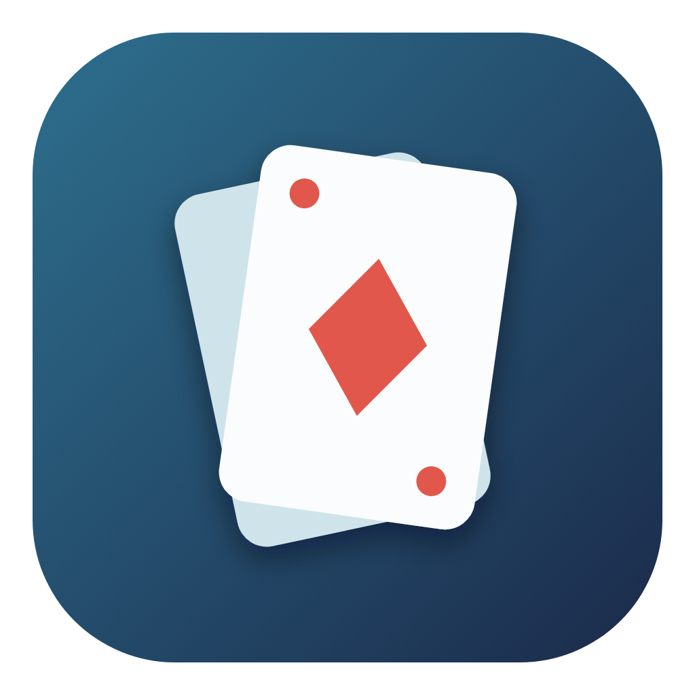

<p align="center"></p>

<h1 align="center">Downtime</h1>
<p align="center">Classic desk games, done cleanly. One small Windows app.</p>

## Games

| Cards | Puzzles and arcade |
| --- | --- |
| **Klondike** — draw 1 or draw 3 | **Minesweeper** — easy, medium, hard |
| **Spider** — 1, 2 or 4 suits | **Snake** — three speeds, walls or wrap-around |
| **FreeCell** | **2048** |

Every game has smooth animations, a timer or score, and personal bests. The card games and 2048 have unlimited undo, and games in progress are saved when you leave, so you can pick up where you left off.

**Themes:** Paper, Slate, Felt, Midnight and Ember, plus three card backs. Switch from the dots at the bottom of the sidebar or in Settings.

## Download

Grab the latest build from [Releases](../../releases):

- **Downtime-portable.exe** — no install, just run it.
- **Downtime_x.y.z_x64-setup.exe** — installs with a Start menu shortcut.

Downtime needs Microsoft Edge WebView2, which comes with Windows 10 and 11.

## Controls

| | |
| --- | --- |
| Cards | Drag to move. Click a card to send it to the best spot. Click the stock to deal. |
| Minesweeper | Left-click to reveal, right-click (or Ctrl+click) to flag. Click a number to clear around it. |
| Snake | Arrow keys or WASD. Space to pause. |
| 2048 | Arrow keys or WASD, or swipe. |
| Anywhere | **Ctrl+Z** undo, **F2** new game. |

## Building it yourself

You need [Node.js 22+](https://nodejs.org) and [Rust](https://rustup.rs).

```sh
npm install
npm run tauri dev     # run the app with live reload
npm run tauri build   # make the .exe and installers in src-tauri/target/release
```

`npm run dev` runs just the web version in a browser at http://localhost:1420, which is the quickest way to work on the games.

### Releasing

Every push to `main` builds Windows installers on GitHub Actions (look under the run's **Artifacts**). To publish a release, bump the version in `package.json` and `src-tauri/tauri.conf.json`, then push a tag:

```sh
git tag v0.2.0
git push origin v0.2.0
```

## Project layout

```
src/
  core/      settings, stats, sound, timer, storage
  cards/     card engine shared by the solitaire games
  games/     one file per game
  ui/        home-screen art and icons
  styles/    themes and layout
src-tauri/   the Windows app wrapper (Tauri 2)
```

Adding a game means writing one module in `src/games/` that exports a `GameModule` and listing it in `src/games/index.ts`.

## License

MIT
